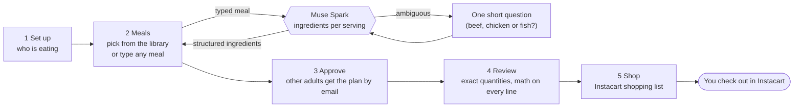
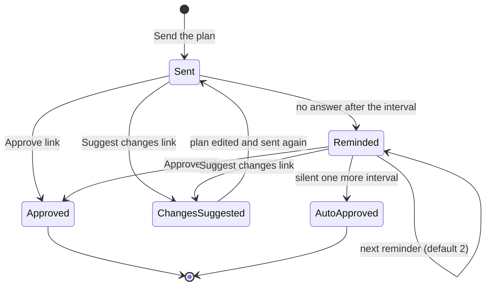
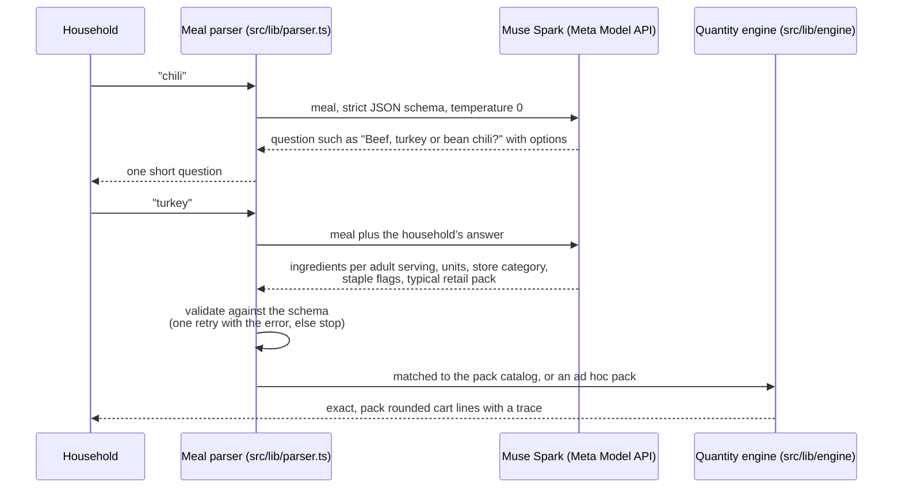
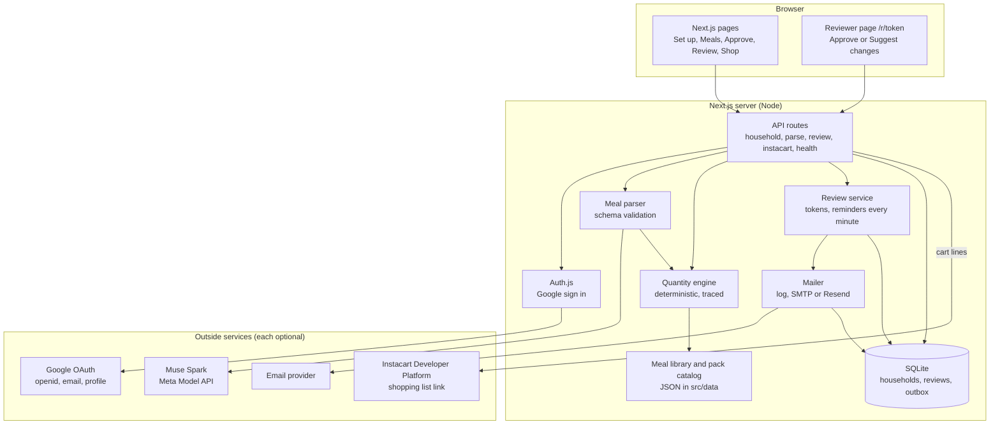
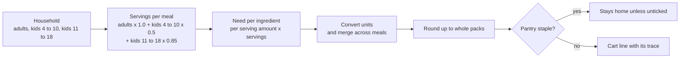
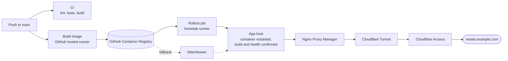

# Family Meal Planner

Plan the family's meals in plain words and get the exact groceries for the people actually eating, in your Instacart cart.

Family Meal Planner turns a week of meals into a grocery list sized to the household. You say who is eating, pick meals from a family library or type any meal you like, and the other adults approve the plan by email. The app then works out exact quantities, merges shared ingredients across meals, rounds up to the pack sizes stores actually sell, keeps pantry staples home, and hands the list to the family's Instacart cart. You check out in Instacart; the planner never places or pays for an order.

Built for the Meta Global AI Developer Hackathon (Indie track, Build for Your World), with Muse Spark on the Meta Model API.

Demo video (3 minutes): [family-meal-planner-demo.mp4](https://github.com/jaccrocker/family-meal-planner/releases/download/v0.1.0/family-meal-planner-demo.mp4)

## Contents

- [Why it exists](#why-it-exists)
- [Try it](#try-it)
- [How a week flows](#how-a-week-flows)
- [What Muse Spark made possible](#what-muse-spark-made-possible)
- [Technical architecture](#technical-architecture)
- [How it works](#how-it-works)
- [Configuration](#configuration)
- [Roadmap](#roadmap)
- [Prior work](#prior-work)
- [Homelab test deploy](#homelab-test-deploy)
- [Run the published image](#run-the-published-image)
- [Install notes](#install-notes)

## Why it exists

Planning the week's dinners takes ten minutes. Turning that plan into a grocery list takes an hour: guessing how much chicken feeds two adults and two kids, noticing that three meals share an onion, remembering that tortillas come in packs of ten, and checking what is already in the pantry. Most of that hour is arithmetic, and the arithmetic is where the overbuying and the second trip to the store come from.

Family Meal Planner does that hour for you, and shows its working on every line so you can trust the cart.

## Try it

Needs Node 22 or later.

```
npm install
npm run dev
```

Open http://localhost:3000 for an overview of what the app does, then choose Try the demo. With no keys set, the app runs in demo mode: a sample family of four (2 adults, one kid 4 to 10, one kid 11 to 18) and a planned week. Nothing to sign in to, and nothing is ordered or emailed.

A two minute walk through for judges:

1. Set up: change who is eating and watch the servings per meal update.
2. Meals: swap a dinner, or type a meal outside the library (tacos asks one short question first).
3. Approve: see the approval email the other adults get, with Approve and Suggest changes buttons. In demo mode nothing is emailed; signed in, it goes to each adult in the household.
4. Review: see every grocery line with its math, and untick what you already have.
5. Shop: copy the list, or with an Instacart key open it as an Instacart shopping list. The planner stops at the cart; checkout stays in Instacart.

Run the checks with `npm test` (61 tests), `npm run lint` and `npm run build`.

## How a week flows

Five steps, each a page in the app. The model is involved in exactly one of them.



The approval step keeps the household in the loop without letting an unanswered email hold up dinner:



Each adult gets their own link, and a newer plan replaces older links. The plan counts as approved once every required reviewer has approved or been approved automatically; optional reviewers get the email but never hold it up. The planner owner gets a short note each time someone responds.

## What Muse Spark made possible

A meal planner that does real quantity math has always had a ceiling: it can only plan meals someone has already broken down by hand. Every meal needs its ingredients, an amount per serving for each one, and the pack size the store sells, before a single line of the cart can be calculated. The 33 meals in this app's library took that work, one ingredient at a time. A family that wants something outside the library, which is most weeks, was back to guessing.

Muse Spark removes that ceiling. A household types any meal in plain words, and Muse Spark turns it into the same structured ingredient data the library meals carry, so the typed meal flows through the exact same quantity engine, approval email and Instacart list as a curated one. That is the capability the author could not build before: an open ended meal planner whose grocery math still holds up.



What Muse Spark does, and only this:

| Muse Spark's job | Why it matters |
|---|---|
| Names the ingredients a shopper would search for ("chicken thighs", not "protein") | The names match the pack catalog and Instacart's product search |
| Gives an amount per adult serving, in consistent units (oz for meat, pasta and cheese; each for produce; fl oz or tbsp for liquids) | The engine can scale and convert without guessing at units |
| Suggests the typical store package for anything not in the catalog (feta 6 oz, canned tomatoes 14.5 oz) | Pack rounding works for meals the catalog has never seen |
| Flags pantry staples (salt, oil, butter, garlic, dried herbs) | Staples stay out of the cart unless unticked |
| Asks one short question, with 2 to 4 options, when a meal is ambiguous in a way that changes the groceries | No silent guess between beef and chicken |

What Muse Spark never does: it never multiplies by the household, merges meals, converts units, rounds packs or touches the cart. That is plain, tested code, so the same week always gives the same cart and every line can be traced back to its inputs.

Muse Spark is a strong fit for this role. The task is half language and half structure: reading a casual meal name the way a home cook means it, then answering in a strict format a program can check. Muse Spark handles both in one call, and the prompt leans on its grocery vocabulary and its sense of everyday package sizes, so a validated reply drops straight into a deterministic engine. Its willingness to ask one sensible question rather than invent an answer is what makes the feature safe to put in front of a family.

Guard rails in the code:

- Replies are requested as JSON at temperature 0 and validated with a Zod schema (`ParsedMealSchema`); a reply that fails gets one retry with the validation error, and a second failure is reported rather than guessed around.
- A suggested pack is used only when its unit family matches the ingredient (weight with weight, count with count); otherwise a category default applies.
- Answers are cached per meal and answer, so the same typed meal gives the same groceries within a session.
- Three sample meals (tacos, chicken tikka masala, shrimp stir fry) always replay hand written answers from `src/data/parser-fixtures.json`, so demo mode works with no key. Those samples were written to match the schema; they are not recorded model output. Every other typed meal goes to Muse Spark when `MODEL_API_KEY` is set.

## Technical architecture

One Next.js app serves the pages and the API. Everything that leaves the server goes through a small adapter, and every outside service is optional.



| Layer | Choice | Why |
|---|---|---|
| App | Next.js with TypeScript, standalone server output | Pages and API in one deployable container |
| Sign in | Auth.js with Google, scopes openid, email and profile only | No passwords of its own; no access to Gmail, Calendar or Drive |
| Storage | SQLite through better-sqlite3 on a single volume | A household app needs one file, not a database server |
| Model | Muse Spark through the Meta Model API | Typed meals become structured ingredients |
| Validation | Zod schemas on every model reply and API body | The engine only ever sees data it can trust |
| Shopping | Instacart Developer Platform shopping list links | Instacart matches products at the family's store; checkout stays there |
| Email | Nodemailer (SMTP) or Resend, with an allowlist | Real approval email for the household, recorded only in test mode |
| Tests | Vitest, 61 tests across the engine, parser, planner, Instacart adapter, review flow and integrations | The math is the product, so the math is tested |

## How it works

The model reads meals; plain code does the math; adapters hand off the list.

| Piece | What it does | Where |
|---|---|---|
| Meal library | 33 family meals (6 breakfasts, 12 lunches, 15 dinners) with ingredients and per serving amounts | `src/data/meals.json`, `src/data/amounts.json` |
| Pack catalog | 73 grocery items with store section and pack size | `src/data/catalog.json` |
| Quantity engine | Weighs each age band, scales per serving amounts, converts units, merges across meals, rounds up to whole packs, keeps staples home, and records a trace for every line | `src/lib/engine` |
| Meal parser | Breaks a meal typed outside the library into ingredients per serving with Muse Spark, validated against a schema; asks a short question when a meal is ambiguous | `src/lib/parser.ts` |
| Instacart adapter | Builds one shopping list page per week through the Instacart Developer Platform; a copy the list fallback works with no key | `src/lib/instacart.ts` |
| Household store | Household, up to 10 other adults and the saved week, keyed by Google account id | `src/lib/store.ts` |
| Household approval | Emails the week to the other adults with Approve and Suggest changes links, reminds on a schedule, and counts silence as approval after the last reminder; one link per adult, replaced when a newer plan goes out | `src/lib/review` |

### The quantity math



All three multipliers are editable. The same week always produces the same cart; `npm test` covers the engine.

Leftover lunches add no groceries of their own; each adds a lunch's servings to the dinner it comes from. Takeout night adds nothing. Salt, pepper, olive oil, butter, garlic and dried herbs start as pantry staples and stay out of the cart until unticked.

### Google sign in

Sign in uses Auth.js with Google, asking only for openid, email and profile. The app keeps the Google account id, name and email; no passwords of its own and no access to Gmail, Calendar or Drive. The first person to sign in owns the household and can add up to 10 other adults by Google email. They sign in with their own Google account and see the same plan; an adult who signs in before being added moves into the household once the owner adds them.

### Approval email

Approval email runs in one of two modes. In test mode (the default) every message is written to an outbox table and the server log, and the Approve page says so. With a transport configured, messages go out for real, and `EMAIL_ALLOWLIST` limits real mail to the addresses listed, so a test never reaches anyone else. Reviewer links carry a random token stored only as a hash.

### Built but switched off

Three integrations are in the code and switched off for judging, each behind its own setting: adding the approved week to a shared Google Calendar (`FEATURE_CALENDAR`), asking Alexa what is for dinner (`FEATURE_ALEXA`, skill in `integrations/alexa`), and showing meals on a Skylight frame through its calendar (`FEATURE_SKYLIGHT`). With the settings off, none of their pages, links or requests appear.

## Configuration

Copy `.env.example` to `.env.local` and fill in what you need. Every setting is optional.

| Setting | Turns on |
|---|---|
| `AUTH_SECRET`, `AUTH_GOOGLE_ID`, `AUTH_GOOGLE_SECRET` | Google sign in and saved households |
| `MODEL_API_KEY` (optional `MODEL_API_BASE_URL`, `MODEL_NAME`) | Muse Spark for typed meals through the Meta Model API |
| `INSTACART_API_KEY`, `INSTACART_ENV` | Live Instacart shopping list links |
| `EMAIL_TRANSPORT`, `EMAIL_FROM`, `EMAIL_ALLOWLIST`, `APP_URL` | Real approval emails (`log` records them only; `smtp` or `resend` sends them; the allowlist limits who gets real mail) |
| `SMTP_HOST`, `SMTP_PORT`, `SMTP_USER`, `SMTP_PASS` or `RESEND_API_KEY` | The email provider for `smtp` or `resend` |
| `FEATURE_CALENDAR`, `FEATURE_ALEXA`, `FEATURE_SKYLIGHT` | The switched off integrations above |

## Roadmap

Everything below is envisioned, not shipped. The first group is already prototyped in the code and switched off; the rest depends on time, partner access and, for the iPhone app, Meta's support.

### Next: finish what is built

| Enhancement | What it adds | Status |
|---|---|---|
| Google Calendar | Writes the approved week to a shared family calendar, one event per meal, and updates it when the plan changes | Built behind `FEATURE_CALENDAR`; needs a calendar scope added to sign in, with a clear consent screen, and a production Google review |
| Skylight frame | Shows tonight's dinner on the kitchen Skylight display through its calendar feed, so the plan is visible where the family already looks | Built behind `FEATURE_SKYLIGHT`; depends on the Calendar integration |
| Alexa | Answers "what is for dinner?" from the approved plan | Skill in `integrations/alexa` behind `FEATURE_ALEXA`; needs account linking and skill certification |

### Later: more places to plan and shop

- **Other grocers and carts.** Add Walmart, Kroger and Amazon Fresh adapters beside Instacart, using the same cart lines, so a family shops where it already does. Checkout stays with the retailer.
- **Pantry memory.** Remember what was bought and what was left over, so staples and leftovers carry from one week to the next instead of being re-ticked by hand.
- **Dietary needs and budgets.** Per-person allergies and preferences, flagged on library and typed meals, plus a weekly budget estimate from catalog pack prices.
- **Reminders and lists.** Send the finished list to Apple Reminders or Google Tasks, and nudge the household the day before a planned shop.
- **Smart home and messaging.** Dinner-time cues through Google Home and a plan summary by text message to adults who prefer it over email.
- **Meal history.** A record of what the family actually cooked, used to suggest rotations and to bring back the meals people asked for again.

### A native iPhone app, if Meta supported the build with credits

The web app already works on a phone, but a native iPhone app is where this fits into a family's day: at the store, in the kitchen, and on the lock screen. It is the largest item here, and it is realistic only with sustained model access, so it is explicitly conditional on Meta providing Meta Model API credits for development and testing.

What the credits would pay for:

- **Muse Spark usage while building.** Typed meals, follow-up questions and ingredient suggestions all call the model, and a native app multiplies that traffic across development, TestFlight and prompt tuning.
- **On-device and in-store flows.** Photograph a recipe card, a fridge shelf or a pantry and have Muse Spark turn it into structured ingredients, using the same schema and quantity engine as today.
- **Evaluation.** A larger test set of typed meals across cuisines and household sizes, to measure how often ingredients, units and pack suggestions come back right before shipping to families.

What the app would add on the phone:

| Capability | Why it matters |
|---|---|
| Native SwiftUI app sharing the existing API, schema and quantity engine | One source of truth for the math; the model still never touches the cart |
| Push notifications for approval requests and reminders | Adults answer from the lock screen instead of finding an email |
| Widgets and Live Activities for tonight's dinner and the shopping list | The plan is visible without opening the app |
| Siri and App Intents ("add chili to Thursday") | Plan by voice while cooking |
| Offline shopping list with store aisle order | The list works in a store with poor signal |
| Share sheet and photo input | Send a recipe from Safari or a photo of a card straight into the week |
| Family sharing and Sign in with Apple | Matches how iPhone households already share |

The same guard rails would carry over: validated JSON from the model, one short question when a meal is ambiguous, and checkout always in the retailer's own app.

## Prior work

This is a new codebase written during the hackathon, starting 10/30/26 (see the commit history). It shares its name and some ideas with the author's conceptual idea for a family meal planner project, and the 33 preloaded meals and their ingredient lists come from gathering some source data (imported with `npm run import-meals`). Per serving amounts and pack sizes were drafted for this project and reviewed by hand.

## Homelab test deploy



The `deploy/` folder and `.github/workflows/deploy.yml` follow the homelab app factory pattern. Each push to `main` builds `ghcr.io/jaccrocker/family-meal-planner:latest` on a GitHub hosted runner. The app host runs it from `deploy/compose-service.yml` behind Nginx Proxy Manager, the Cloudflare tunnel and Cloudflare Access at `meals.example.com`, and a rollout job on the homelab runner pulls each new image as soon as it is built and confirms the running container is that build; Watchtower is the fallback. Host addresses come from repository settings, not the repository itself. Runtime settings are listed in `deploy/runtime.env.example`; saved households live in a SQLite file on the `/data` volume.

## Run the published image

Tagged releases publish a container image with build provenance. Runtime settings are listed in `deploy/runtime.env.example`; saved households live in a SQLite file on the `/data` volume.

```bash
docker run -p 3000:3000 -v fmp-data:/data --env-file runtime.env \
  ghcr.io/jaccrocker/family-meal-planner-public:0.1.0
```

Releases and the changelog are on the [Releases page](https://github.com/jaccrocker/family-meal-planner/releases); maintainers follow the steps in [CONTRIBUTING.md](CONTRIBUTING.md).

## Install notes

No dependency needs an install script. better-sqlite3 ships prebuilt binaries for macOS, Linux and Windows, and esbuild, fsevents and unrs-resolver run without their postinstall steps, so `package.json` declines all four under `allowScripts` and npm installs without prompting. On older npm, `npm ci --ignore-scripts` gives the same result; CI and the Docker build use it.

`npm audit` reports moderate findings in development tools only (ESLint's minimatch and the exceljs workbook importer). The app's runtime dependencies have none (`npm audit --omit=dev`), and the remaining fixes need breaking major upgrades of ESLint and exceljs, so they wait until after the hackathon.

## License

MIT
